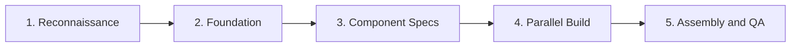

<div align="center">

# AI Website Cloner

[](https://github.com/innotelinc/wsclone/actions/workflows/ci.yml)
[](LICENSE)

**Give an AI coding agent a URL and get back a clean, editable Next.js app.**

[Landing page](https://innotelinc.github.io/wsclone/) · [Quick start](#quick-start) · [Supported agents](#supported-agents)

</div>

> **AI Website Cloner** is the BuilderOps template that turns a live website into
> a Next.js 16 repository a person can read and maintain: a pre-scaffolded
> Next.js + shadcn/ui + Tailwind v4 app plus the `/clone-website` skill that
> walks the target, extracts its design tokens and rebuilds each section as a
> component.
>
> It is a maintained copy of
> [JCodesMore/ai-website-cloner-template](https://github.com/JCodesMore/ai-website-cloner-template)
> (MIT, copyright retained there); this repository keeps the template and its
> skills in the Innotel workspace. It consumes an AI coding agent and the
> target's public pages, and — where it is hosted — Cerulean Vault for secrets.
> Landing page: [innotelinc.github.io/wsclone](https://innotelinc.github.io/wsclone/).

---

## Why AI Website Cloner

| Problem | Answer |
| --- | --- |
| Rebuilding a site by hand is slow. | An agent walks the pages and writes the components. |
| A cloned site is usually a mess. | The output is a small Next.js app with a structure a person can edit. |
| One agent tries to hold the whole site in context. | The pipeline writes component specs first, then parallel builder agents build each section in its own worktree. |
| "Close enough" drifts from the original. | Assembly runs a visual diff against the target before the page is wired up. |

Its place in the stack is [docs/stack.md](docs/stack.md); the canonical
definition of the shared layers is the
[Innotel Platform Stack](https://github.com/innotelinc/innotel-platform-stack).

## What it is

- **A template, not a service** — the Next.js 16 app, `AGENTS.md` rules and the
  `/clone-website` skill, ready to copy per site.
- **A five-phase pipeline** — reconnaissance, foundation, component specs,
  parallel build in git worktrees, assembly and visual QA.
- **Multi-agent by construction** — the skill is generated for Claude Code,
  Codex CLI, OpenCode, Copilot, Cursor, Windsurf, Gemini CLI, Cline, Roo Code,
  Continue, Amazon Q and Augment Code from one source.
- **A typed base** — Next.js 16 App Router, React 19, TypeScript strict,
  shadcn/ui primitives, Tailwind CSS v4 tokens and Lucide icons to replace.
- **Containers when you want them** — a dev image and a multi-stage production
  build in `docker-compose.yml`.

## Quick start

> Make your own copy first — do not build a site in this repository.

1. **Create your copy** with GitHub's **Use this template** button on
   [innotelinc/wsclone](https://github.com/innotelinc/wsclone/generate).
2. **Clone your copy** and install dependencies:

   ```bash
   git clone https://github.com/YOUR-USERNAME/YOUR-NEW-REPOSITORY.git
   cd YOUR-NEW-REPOSITORY
   npm install
   ```

3. **Start your agent** — Claude Code is the recommended client:

   ```bash
   claude --chrome
   ```

4. **Run the skill** with one or more target URLs:

   ```
   /clone-website <target-url1> [<target-url2> ...]
   ```

5. **Customize** once the base clone is built.

Clients that activate skills from natural-language requests can use
`Clone <target-url> using the clone-website workflow`. Project instructions live
in [AGENTS.md](AGENTS.md).

## Supported agents

| Agent | Status |
| --- | --- |
| [Claude Code](https://docs.anthropic.com/en/docs/claude-code) | **Recommended** |
| [Codex CLI](https://github.com/openai/codex) | Supported |
| [OpenCode](https://opencode.ai/) | Supported |
| [GitHub Copilot](https://github.com/features/copilot) | Supported |
| [Kiro](https://kiro.dev/) | Supported |
| [Cursor](https://cursor.com/) | Supported |
| [Windsurf](https://codeium.com/windsurf) | Supported |
| [Gemini CLI](https://github.com/google-gemini/gemini-cli) | Supported |
| [Cline](https://github.com/cline/cline) | Supported |
| [Roo Code](https://github.com/RooCodeInc/Roo-Code) | Supported |
| [Continue](https://continue.dev/) | Supported |
| [Amazon Q](https://aws.amazon.com/q/developer/) | Supported |
| [Augment Code](https://www.augmentcode.com/) | Supported |

Node.js 24 or newer is required; `.nvmrc` pins it.

## How it works



1. **Reconnaissance** — screenshots, design-token extraction and an interaction
   sweep (scroll, click, hover, responsive breakpoints).
2. **Foundation** — fonts, colours, globals and every asset downloaded.
3. **Component specs** — one spec per section with exact `getComputedStyle()`
   values, states, behaviour and content (`docs/research/components/`).
4. **Parallel build** — builder agents work in git worktrees, one per section.
5. **Assembly and QA** — the worktrees are merged, the page wired up and a
   visual diff run against the original.

Each builder receives its spec inline, so it is not guessing at spacing, states
or breakpoints.

## Project structure

```
src/
  app/                 # Next.js routes
  components/          # React components
    ui/                # shadcn/ui primitives
    icons.tsx          # Extracted SVG icons
  lib/utils.ts         # cn() utility
  types/               # TypeScript interfaces
  hooks/               # Custom React hooks
public/
  images/              # Downloaded images from the target
  videos/              # Downloaded videos from the target
  seo/                 # Favicons, OG images
docs/
  research/            # Extraction output and component specs
  design-references/   # Screenshots
scripts/
  sync-agent-rules.sh  # Regenerate agent instruction files
  sync-skills.mjs      # Regenerate /clone-website for every client
AGENTS.md              # Agent instructions (single source of truth)
CLAUDE.md              # Claude Code config (imports AGENTS.md)
GEMINI.md              # Gemini CLI config (imports AGENTS.md)
```

## Commands

```bash
npm run dev        # Start dev server
npm run build      # Production build
npm run lint       # ESLint check
npm run typecheck  # TypeScript check
npm run check      # lint + typecheck + build
```

With Docker:

```bash
docker compose up app --build   # production build
docker compose up dev --build   # dev mode on port 3001
```

Two source files drive every client adapter; edit the source, then regenerate:

| What | Source of truth | Regenerate with |
| --- | --- | --- |
| Project instructions | `AGENTS.md` | `bash scripts/sync-agent-rules.sh` |
| `/clone-website` skill | `.claude/skills/clone-website/SKILL.md` | `node scripts/sync-skills.mjs` |

## Use cases, and what this is not for

Built for platform migrations you own, recovering a site whose source is gone,
and learning how production sites are put together from real code.

Not for phishing or impersonation, passing off someone else's design as your
own, or any target whose terms forbid scraping. Logos, brand assets and original
copy belong to their owners.

## Documentation

| Document | Covers |
| --- | --- |
| [docs/stack.md](docs/stack.md) | The template's role in the Innotel Platform Stack — owns / consumes boundaries |
| [AGENTS.md](AGENTS.md) | The rules every supported agent follows |
| [CONTRIBUTING.md](CONTRIBUTING.md) | Contribution flow and local checks |
| [SECURITY.md](SECURITY.md) | Private vulnerability reporting |
| [CHANGELOG.md](CHANGELOG.md) | Release history, including the upstream 0.4.0 baseline |
| [README.ja.md](README.ja.md) · [README.zh-CN.md](README.zh-CN.md) | Japanese and Simplified Chinese translations |

## License

MIT — see [LICENSE](LICENSE). The licence and copyright of the upstream
template ([JCodesMore/ai-website-cloner-template](https://github.com/JCodesMore/ai-website-cloner-template),
© 2025 JCodesMore) are retained unchanged; this repository's additions are
released under the same terms.

---

© 2026 Innotel — AI Website Cloner, BuilderOps. Part of the
[Innotel Platform Stack](https://github.com/innotelinc/innotel-platform-stack) ·
[GitHub](https://github.com/innotelinc/wsclone) ·
[Landing](https://innotelinc.github.io/wsclone/)
